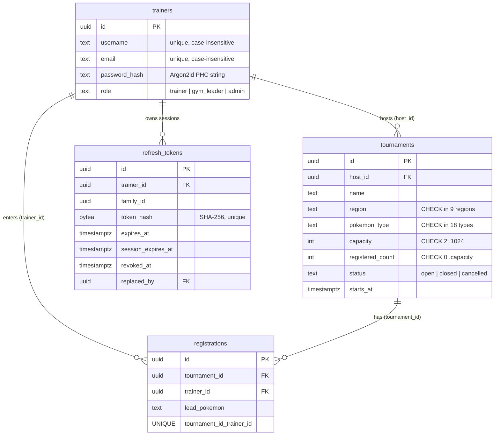
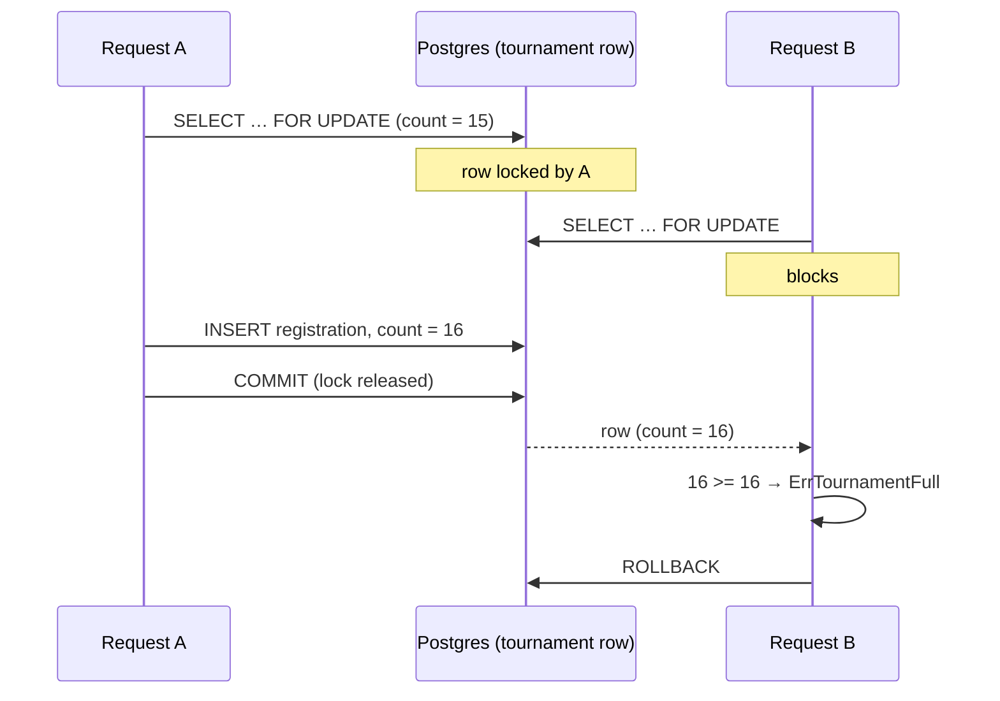

# Design decisions and trade-offs

This document explains *why* the Pokémon League API is built the way it is. For each decision it states what was chosen, what the alternatives were, and what was given up. Section numbers are referenced from the code comments and the README.

**Contents**

1. [Domain and requirements](#1-domain-and-requirements)
2. [Architecture](#2-architecture)
3. [Data model](#3-data-model)
4. [Concurrency: capacity-limited registration](#4-concurrency-capacity-limited-registration)
5. [Authentication](#5-authentication)
6. [Authorization (RBAC)](#6-authorization-rbac)
7. [Pagination, filtering and sorting](#7-pagination-filtering-and-sorting)
8. [API conventions](#8-api-conventions)
9. [Operational readiness](#9-operational-readiness)
10. [Running it on AWS](#10-running-it-on-aws)
11. [Testing strategy](#11-testing-strategy)
12. [Known limitations and next steps](#12-known-limitations-and-next-steps)

---

## 1. Domain and requirements

| Concept | Meaning |
|---|---|
| **Trainer** | An account. Every account is a trainer; its *role* decides what else it may do. |
| **Gym leader** | A role that can host tournaments (and still compete in other leaders' events). |
| **Admin** | League staff: manages any tournament and assigns roles. Does not compete. |
| **Tournament** | A capacity-limited event in a region (Kanto, Johto…) themed on a Pokémon type. |
| **Registration** | A trainer's entry into a tournament, with their lead Pokémon. |

The theme maps one-to-one onto the brief's "Users ↔ Events via Registrations" example, which was chosen deliberately: it contains a genuine many-to-many relationship, a natural ownership rule (a gym leader manages *their* tournament), and a natural concurrency hazard (the last spot).

---

## 2. Architecture

### 2.1 Layers

```
 HTTP request
     │
┌────▼──────────────────────────────────────────────────────────┐
│ httpapi   routing · middleware · decode/encode · error mapping │  knows HTTP, not SQL
├───────────────────────────────────────────────────────────────┤
│ service   use cases · business rules · permission checks       │  knows rules, not HTTP or SQL
│           owns transaction boundaries                          │
├───────────────────────────────────────────────────────────────┤
│ store     SQL · row scanning · SQL error → domain error        │  knows SQL, not rules
├───────────────────────────────────────────────────────────────┤
│ PostgreSQL  constraints · row locks · indexes                  │  last line of defence
└───────────────────────────────────────────────────────────────┘
   domain / rbac / auth: pure types and functions used by all layers
```

The dependency direction is strictly downward. The practical payoff:

- **Business rules are testable and reusable without HTTP.** The concurrency and refresh-token tests call the service directly. A future CLI or queue consumer gets the same rules for free.
- **Errors are translated once per boundary.** The store turns Postgres `23505` (unique violation on `registrations_tournament_trainer_key`) into `domain.ErrAlreadyRegistered`; the HTTP layer turns that into `409` with code `already_registered`. Neither layer knows the other's vocabulary.
- **Transactions are a service concern, SQL is a store concern.** `store.WithTx(ctx, func(tx *Store) error)` hands the service a transaction-scoped store. The service decides *what* must be atomic; the store decides *how* to query. This avoids both "SQL in the service" and "business rules hidden in a repository method".

**Trade-off:** three layers is more ceremony than a 10-endpoint API strictly needs. It was kept because the brief asks for production structure and because each layer earns its place (see the tests that bypass HTTP). Interfaces were *not* added between service and store: there is one implementation, and the tests use real Postgres, so an interface would be abstraction without a second user.

### 2.2 Technology choices

| Choice | Alternatives | Why |
|---|---|---|
| **Go standard library `net/http`** router | chi, gin, echo | Since Go 1.22 `ServeMux` supports methods and path parameters (`"POST /v1/tournaments/{id}/registrations"`), and returns `405` with an `Allow` header automatically. A framework would add a dependency for no capability we use. |
| **pgx v5** directly | `database/sql` + lib/pq, GORM, sqlc | pgx is the most actively maintained Postgres driver for Go, exposes `*pgconn.PgError` with constraint names (needed for precise error mapping), and has a first-class pool. No ORM: the interesting parts of this service (`FOR UPDATE`, row-value keyset predicates, CTEs) are exactly what ORMs obscure. sqlc would be a reasonable next step for compile-time-checked queries. |
| **PostgreSQL 16** | MySQL, DynamoDB | Mature row-level locking, `CHECK` constraints, partial/functional indexes, transactional DDL (so a failed migration rolls back cleanly). DynamoDB is discussed in §10.3. |
| **log/slog** JSON | zap, zerolog | Standard library since Go 1.21, structured, fast enough. JSON lines are what CloudWatch Logs Insights queries best. |
| **4 direct dependencies** | — | `pgx`, `golang-jwt/jwt/v5`, `google/uuid`, `golang.org/x/crypto`. Every dependency is supply-chain surface; CI runs `govulncheck` over them. |

---

## 3. Data model



### 3.1 Decisions

**A real join table, not an array or JSON column.** `registrations` is its own table with two foreign keys and `UNIQUE (tournament_id, trainer_id)`. That gives referential integrity (no registration for a non-existent tournament), a database-enforced "one entry per trainer", per-registration data (`lead_pokemon`, `created_at`), and efficient queries in both directions (the unique constraint's index serves "who is in tournament X"; `registrations_trainer_id_idx` serves "what is trainer Y in").

**Invariants are enforced twice: in Go and in the schema.** Go validation produces friendly, field-level errors. Schema constraints (`CHECK`, `UNIQUE`, `FOREIGN KEY`) guarantee correctness even if a bug, a manual SQL session or a future second service bypasses the Go code. The most important one:

```sql
CONSTRAINT tournaments_registered_count_within_capacity
    CHECK (registered_count >= 0 AND registered_count <= capacity)
```

**`text` + `CHECK` for enumerations**, rather than Postgres `ENUM` types or lookup tables. Adding a value to a `CHECK` is a plain constraint swap; removing a value from a Postgres `ENUM` is not supported directly. Lookup tables (`regions(id, name)`) would be right if regions had their own attributes or were admin-editable; here they are a fixed list from the games. Trade-off: the lists are duplicated in Go and SQL. A test could assert they match; I accepted the duplication for now.

**Case-insensitive uniqueness via functional unique indexes** (`ON trainers (lower(username))`) instead of the `citext` extension. Same guarantee, no extension to install (some managed environments restrict extensions), and lookups use `WHERE lower(username) = lower($1)` which hits the index.

**UUIDv7 primary keys, generated in the application.** UUIDs (rather than `bigserial`) don't leak business volume ("we're order #1,042") and can be generated without a database round trip. Version 7 (RFC 9562) specifically is time-ordered, so new rows are appended to the right edge of the B-tree index instead of landing at random positions as UUIDv4 does, which keeps inserts cache-friendly and reduces index page splits. Trade-off: a v7 id reveals its creation time to anyone who sees it. That's acceptable for tournaments and registrations, whose `created_at` is returned anyway.

**`ON DELETE` behaviour was chosen per relationship:**

| FK | Rule | Reason |
|---|---|---|
| `registrations.tournament_id` | `CASCADE` | A deleted tournament's entries are meaningless; the counter disappears with the row. |
| `registrations.trainer_id` | `RESTRICT` | Cascading would silently delete registrations **without** decrementing `registered_count`, corrupting the invariant. Deleting a trainer must go through a service method that withdraws them properly. |
| `tournaments.host_id` | `RESTRICT` | A tournament must not lose its host silently. |
| `refresh_tokens.trainer_id` | `CASCADE` | Sessions of a deleted account should vanish. |

### 3.2 The denormalised `registered_count`

"How many spots are left?" can be answered three ways:

| Approach | Read cost | Write cost | Risk |
|---|---|---|---|
| `COUNT(*)` from `registrations` each time | O(n) per tournament, and per row in a list | none | lists get slower as events fill |
| **Counter column updated in the same transaction** (chosen) | O(1), free in list queries and filterable (`has_spots`) | one extra `UPDATE` per registration | counter could drift from reality if a code path forgets it |
| Counter maintained by a trigger | O(1) | same | logic hidden from the application code |

The drift risk of the chosen approach is closed by three things: every write path goes through `service.Register` / `service.Withdraw`; the `CHECK` constraint makes an over-count impossible; and the concurrency test asserts `registered_count == COUNT(*)` after the race. A trigger is a defensible alternative (it can't be forgotten); I preferred keeping the critical logic visible in Go where it is reviewed and tested alongside the lock.

---

## 4. Concurrency: capacity-limited registration

### 4.1 The bug this prevents

The obvious implementation is a race condition:

```go
t := store.GetTournament(id)          // both requests read registered_count = 15 (capacity 16)
if t.RegisteredCount < t.Capacity {   // both pass the check
    store.InsertRegistration(...)     // both insert
    store.IncrementCount(id)          // count = 17 of 16
}
```

Between the read and the write, another request can do the same read. This is a classic *time-of-check to time-of-use* (TOCTOU) race. It almost never shows up in manual testing, and reliably shows up when tickets for a popular event go on sale.

### 4.2 The solution: a pessimistic row lock

`service.League.Register` runs this in one transaction:

```sql
BEGIN;  -- READ COMMITTED
SELECT set_config('lock_timeout', '3000ms', true);        -- fail fast under a stampede (§4.4)
SELECT ... FROM tournaments t JOIN trainers h ON h.id = t.host_id
 WHERE t.id = $1
   FOR UPDATE OF t;                                        -- ← the serialisation point
-- Go checks: host? open? starts in the future? registered_count < capacity?
INSERT INTO registrations (...) VALUES (...);              -- UNIQUE catches double entry
UPDATE tournaments SET registered_count = registered_count + 1 WHERE id = $1;
COMMIT;
```

`FOR UPDATE` takes an exclusive row-level lock on that tournament's row until the transaction ends. A second transaction that reaches the same `SELECT … FOR UPDATE` **blocks** until the first commits, and then reads the *committed* value of `registered_count`. So the check and the write are effectively atomic per tournament, and at most `capacity` transactions can pass the check.



Why this is the right granularity:

- **Locks one row, not the table.** Registrations for *different* tournaments lock different rows and proceed in parallel. Only requests competing for the same scarce resource wait for each other, which is exactly the set that *must* be ordered.
- **`FOR UPDATE OF t`** locks only the tournament, not the joined host row, so registrations don't contend with (say) the host updating their profile.
- **READ COMMITTED is sufficient** because correctness comes from the explicit lock, not from the isolation level. That means no serialization failures to retry (contrast with §4.5c).
- **Atomic increment** (`SET registered_count = registered_count + 1`) rather than writing back a value computed in Go, so even the counter update itself can't lose an update.

### 4.3 Avoiding deadlocks

A deadlock needs two transactions taking the same locks in opposite orders. Every write that touches registrations (`Register`, `Withdraw`, `UpdateTournament`) takes **the tournament row lock first**, then touches `registrations`. With one global order, the lock graph can't contain a cycle. `UpdateTournament` also locks first so its "capacity can't go below current registrations" check can't race with an in-flight registration.

### 4.4 Behaviour under a stampede

Serialising on one row means a hot tournament processes registrations one at a time. Each transaction is a handful of indexed statements (low milliseconds), so this comfortably handles bursts for a campus-scale league. Without care, though, a stampede has a failure mode: every waiting request holds a pooled database connection while it queues, the pool drains, and *unrelated* endpoints start timing out.

Two bounds prevent that:

- `SET LOCAL lock_timeout = '3s'` (configurable via `DB_LOCK_TIMEOUT`): a request that can't get the lock in time fails with Postgres `55P03`, mapped to **`503` + `Retry-After`** (`code: busy`), so the client retries instead of hanging.
- A per-request context deadline (`REQUEST_TIMEOUT`, default 10s) cancels any query still running when the request budget is spent.

For a truly massive on-sale (tens of thousands of concurrent buyers for one event), a single-row lock is the bottleneck and the design would change: put requests on a queue (SQS) and process them sequentially, or pre-split capacity into N "slot" rows and lock any free one (`SELECT … FOR UPDATE SKIP LOCKED LIMIT 1`) so N requests proceed in parallel.

### 4.5 Alternatives considered

| Approach | Correct? | Why not chosen |
|---|---|---|
| **a. `SELECT … FOR UPDATE` (pessimistic lock)** | ✅ | **Chosen.** Simple to reason about, no retries, precise error messages (we know *why* it failed: full vs closed vs host). |
| b. Single conditional statement: `UPDATE tournaments SET registered_count = registered_count + 1 WHERE id = $1 AND registered_count < capacity RETURNING …` | ✅ | Also correct and slightly cheaper (the `UPDATE` takes the row lock implicitly). But when 0 rows match you don't know whether the event is full, closed, started, or missing without a second query, and the other business checks (host can't enter) still need the row. A good choice when the rule is *only* capacity. |
| c. `SERIALIZABLE` isolation | ✅ | Postgres detects the conflict and aborts one transaction with `40001`. Requires a retry loop around every transaction, and under contention many attempts abort and redo work. Better suited to complex read-sets where you can't name the row to lock. |
| d. Optimistic locking (`version` column, `UPDATE … WHERE version = $v`) | ✅ | Great when conflicts are rare. Registration for a popular event is *high* contention by nature, so most attempts would fail and retry; pessimistic locking wastes less work there. |
| e. `pg_advisory_xact_lock(hash(tournament_id))` | ✅ | Works, but it's a lock on a number, not on data: nothing stops another code path from writing the row without taking it. The row lock is enforced by the database for every writer. |
| f. Go `sync.Mutex` / in-memory lock | ❌ | Only works within one process. With two replicas behind a load balancer it provides no protection at all. |
| g. Distributed lock (Redis/DynamoDB lease) | ⚠️ | Adds a second system whose lease can expire mid-transaction (GC pause, network partition) while the database has no idea the lock was lost. The database that holds the data is the right place to hold the lock. |

**Defence in depth:** even if the lock were removed, `tournaments_registered_count_within_capacity` would still reject the over-count. Under READ COMMITTED, the second transaction's `UPDATE … SET registered_count = registered_count + 1` waits for the first, then re-evaluates against the newly committed row, finds it would exceed capacity, and fails with `23514`, which the store maps to `ErrTournamentFull`. The lock gives correct *business* errors and ordering; the constraint guarantees the *invariant* no matter what.

### 4.6 Evidence the test actually catches the race

A concurrency test that passes is only meaningful if it would *fail* against broken code. `TestRegister_ConcurrentRequestsNeverExceedCapacity` releases 40 goroutines simultaneously (they all wait on a closed channel) at a 5-spot tournament with a 32-connection pool. I ran it against deliberately broken variants:

| Variant | Result over 3 runs |
|---|---|
| Lock **and** `CHECK` constraint removed (naive check-then-write) | **Failed every run**: 17, 10 and 14 trainers registered for 5 spots |
| Lock removed, `CHECK` kept | Passed: the constraint alone preserved the invariant (§4.5 defence in depth) |
| Shipped code (lock + constraint) | Passed, also under `go test -race` |

### 4.7 The same pattern elsewhere

Refresh-token rotation (§5.3) has the identical hazard (two requests using one token at once) and uses the identical fix: `SELECT … FROM refresh_tokens WHERE token_hash = $1 FOR UPDATE`. A test fires 8 concurrent refreshes with one token and asserts exactly one succeeds.

---

## 5. Authentication

### 5.1 Two tokens, two jobs

| | Access token | Refresh token |
|---|---|---|
| Format | JWT (JWS, `alg: EdDSA`) | 256 random bits, base64url (opaque) |
| Lifetime | 15 minutes | 7 days sliding, 30 days absolute |
| Verified by | signature only: **no DB lookup** | database lookup (by SHA-256 hash) |
| Revocable | no (expires quickly instead) | yes, instantly |
| Sent | every API request (`Authorization: Bearer`) | only to `/v1/auth/refresh` and `/logout` |

This split is the core trade-off of token auth. Stateless access tokens make every request cheap (no session lookup, works across replicas and services) but can't be revoked, so they are kept short. The refresh token is stateful and revocable, but used rarely. The result: a stolen access token is useful for at most 15 minutes, and a stolen refresh token can be detected and killed (§5.3).

`ACCESS_TOKEN_TTL` is configurable but config validation refuses anything over 1 hour, because an unrevocable credential with a long life defeats the purpose.

### 5.2 Access token details

- **Ed25519 (EdDSA, RFC 8037) instead of HS256.** With HMAC, every service that can *verify* a token can also *forge* one, because both use the same secret. With an asymmetric key only this service holds the private key; an API gateway, another microservice or a Lambda authorizer can verify using the public key alone. Ed25519 over RSA because keys and signatures are small, signing is fast, and there are no parameter choices (padding, key size) to get wrong.
- **Algorithm pinning.** Verification accepts only `EdDSA` (`jwt.WithValidMethods`). This defeats two classic attacks, both covered by tests: `alg: none` (unsigned token) and *algorithm confusion*, where an attacker signs an HS256 token using our **public** key as the HMAC secret and a naive verifier, trusting the header's `alg`, accepts it.
- **All registered claims are validated:** `iss`, `aud`, `exp` (required), `iat`, `nbf`, with 30 s leeway for clock skew between hosts. `aud` matters as soon as there is more than one service: a token minted for service A must not work at service B.
- **`kid` header** (a fingerprint of the public key). Today there is one key; the `kid` lets us rotate keys later by publishing a key set and selecting the verification key by id, without invalidating every token at once.
- **Minimal claims:** `sub` (trainer id), `role`, `jti`. No email or PII: JWT payloads are only base64-encoded, not encrypted.
- **Generic failure.** Every verification failure returns `invalid_token`, so an attacker learns nothing from the difference between "expired" and "bad signature".

**Trade-off: role staleness.** The role is embedded in the access token, so after a demotion the old token keeps the old role until it expires (≤ 15 min). Mitigations in place: refresh re-reads the role from the database, and changing a role revokes that trainer's refresh tokens so they must log in again. If instant revocation were required (e.g. a banking app), options are a `jti` deny-list in Redis/ElastiCache checked per request, or a per-user "tokens valid after" timestamp. Both reintroduce a lookup per request, which is the cost the stateless design avoids.

### 5.3 Refresh token rotation and reuse detection

Refresh tokens are **single-use**. Each `/v1/auth/refresh` call:

1. hashes the presented token and locks its row (`FOR UPDATE`);
2. if the row is **already revoked**, this is a *replay*: revoke the **entire family** and return `401 refresh_token_reused`;
3. if expired, return `401 invalid_token`;
4. otherwise re-read the trainer (fresh role), issue a new pair, and mark the old row `revoked_at = now(), replaced_by = <new id>`.

A **family** is every token descended from one login. Why revoke all of them on replay? If a token is used twice, two parties hold it: the real client and (probably) an attacker. The server can't tell which request is which, so it ends the session for both; the real user simply logs in again, the attacker is locked out. This is the refresh-token rotation and reuse-detection approach recommended by the OAuth 2.0 Security Best Current Practice (RFC 9700).

Implementation subtlety worth calling out: on replay, the transaction must **commit** the family revocation. Returning an error from the transaction function would roll the revocation back, so the code records `reused = true`, returns `nil` (commit), and converts it to the error after the transaction (see `service.Auth.Refresh`).

**Sliding plus absolute expiry.** Each rotation extends the refresh token by 7 days, but never past `session_expires_at`, fixed at login (30 days). Without the absolute cap, a stolen token used regularly would live forever.

**Hashing at rest.** Only `SHA-256(token)` is stored. A database dump yields nothing usable. A fast hash is correct here (unlike for passwords): the input already has 256 bits of entropy, so brute-forcing is infeasible regardless of speed, and a deterministic hash allows an indexed lookup.

**Trade-offs:**

- **Legitimate races look like theft.** Two browser tabs refreshing simultaneously with the same token: one wins, the other is treated as reuse and logs the user out. Production systems often add a short grace period (accept the just-rotated token for ~10 s and return the same successor). I kept the strict version for clarity and documented it here.
- **Body vs cookie.** The refresh token is returned in the JSON body, which suits mobile apps and API clients. For a browser SPA the better transport is an `HttpOnly; Secure; SameSite=Strict` cookie scoped to `/v1/auth`, so JavaScript (and therefore XSS) can never read it, at the cost of needing CSRF consideration. That's a deployment decision for the frontend.
- **Logout** revokes the refresh family immediately; the current access token stays valid until it expires (the same 15-minute property as above).

### 5.4 Passwords

- **Argon2id** with the OWASP Password Storage Cheat Sheet baseline (19 MiB memory, 2 iterations, parallelism 1). It is memory-hard, which makes GPU/ASIC cracking expensive, unlike plain SHA-256 or even bcrypt's fixed 4 KiB.
- **PHC string format** (`$argon2id$v=19$m=19456,t=2,p=1$salt$hash`) stores the parameters with each hash. If the cost is raised later, old hashes still verify and are **transparently rehashed on the next successful login** (the only moment the plaintext is available).
- **Constant-time comparison** (`subtle.ConstantTimeCompare`).
- **No username enumeration via timing.** A login for an unknown username still runs a full Argon2id verification against a dummy hash, so "no such user" and "wrong password" take the same time and return the same error.
- **Bounded hashing concurrency.** Memory-hardness cuts both ways: 200 simultaneous logins at 19 MiB each is ~3.7 GiB. A semaphore (`PASSWORD_HASH_CONCURRENCY`, default 8) caps simultaneous hashes, so a login flood queues instead of getting the container OOM-killed.
- **Policy** follows NIST SP 800-63B's direction: length over composition rules. 12-128 characters, no "must contain a symbol". A natural next step is rejecting passwords found in breach corpora (k-anonymity range queries against Have I Been Pwned).

### 5.5 Brute-force protection

`/v1/auth/signup`, `/login` and `/refresh` are rate-limited per client IP with an in-memory token bucket (20/min, burst 10), returning `429` with `Retry-After`. Behind an ALB the client IP is taken from the **last** `X-Forwarded-For` entry (the one the ALB appended); earlier entries are client-controlled and spoofable, so they are ignored. This only happens when `TRUST_PROXY=true`.

**Trade-off:** the limiter is per instance, so N replicas allow N× the rate. It's a first layer. The durable layer belongs at the edge: AWS WAF rate-based rules on the ALB or API Gateway, or a shared counter in ElastiCache.

---

## 6. Authorization (RBAC)

### 6.1 Roles map to permissions, not to `if` statements

```go
RoleTrainer:   {tournament:register}
RoleGymLeader: {tournament:register, tournament:create, tournament:manage_own}
RoleAdmin:     {tournament:create, tournament:manage_any, trainer:manage_roles}
```

Code asks `actor.Role.Can(rbac.PermTournamentCreate)`, never `role == "admin"`. Adding a role is one line in `rbac.go`; auditing "who can create tournaments?" means reading one table. Unknown roles have no permissions (deny by default), and the token verifier rejects tokens whose `role` isn't a known role.

| Endpoint | trainer | gym_leader | admin |
|---|:-:|:-:|:-:|
| List / view tournaments | ✅ | ✅ | ✅ |
| Create tournament | ❌ | ✅ | ✅ |
| Edit tournament / view roster | ❌ | own only | ✅ any |
| Register for tournament | ✅ | ✅ (not own) | ❌ |
| Assign roles | ❌ | ❌ | ✅ (not self) |

### 6.2 Two kinds of check, at two layers

- **Role checks happen at the route**, before the handler runs: `mux.Handle("POST /v1/tournaments", can(rbac.PermTournamentCreate, a.createTournament))`. The routing table doubles as an access-control list a reviewer can read top to bottom.
- **Ownership checks happen in the service**, because they need the resource: "may this gym leader edit *this* tournament?" requires loading it. `canManage(actor, tournament)` is the single policy function for edit and roster access.
- **Services re-check role permissions** even when the router already did. It's cheap and keeps the rule true for every caller of the service, not just HTTP.

### 6.3 Decisions on the edges

- **401 vs 403.** `401` = we don't know who you are (missing/invalid token, with a `WWW-Authenticate` header per RFC 6750). `403` = we know, and your role or ownership doesn't allow it.
- **403 vs 404 for others' resources.** Tournaments are visible to all members, so returning `403` on a rival's tournament leaks nothing. For resources whose *existence* is private (another user's draft, for instance) the right answer is `404`, to avoid an existence oracle.
- **Admins cannot change their own role,** so the last admin can't accidentally lock everyone out.
- **Admins don't compete, hosts can't enter their own event.** Separation of duties: the people who run an event don't play in it.
- **New accounts always get the least-privileged role.** Elevation is an explicit admin action; there is no "role" field on sign-up.

---

## 7. Pagination, filtering and sorting

`GET /v1/tournaments?region=kanto&has_spots=true&sort=-starts_at&limit=20&cursor=…`

### 7.1 Keyset (cursor) pagination instead of `OFFSET`

`LIMIT 20 OFFSET 10000` makes Postgres produce and discard 10,000 rows: cost grows linearly with page depth. It's also unstable: if a row is inserted on an earlier page while a client is paging, every later row shifts by one and the client sees a duplicate (or misses one, on delete).

Keyset pagination remembers the last row seen and asks for rows *after* it:

```sql
WHERE (t.starts_at, t.id) > ($last_starts_at, $last_id)
ORDER BY t.starts_at ASC, t.id ASC
LIMIT 21
```

- The **row-value comparison** `(a, b) > (x, y)` means `a > x OR (a = x AND b > y)`, and with the composite index `(starts_at, id)` it is a single index range scan. Page 1,000 costs the same as page 1.
- **`id` is always the tiebreaker.** Several tournaments can start at the same time; without a unique tiebreaker the order is not total and rows at a page boundary can be skipped or repeated. The test creates tournaments in pairs with identical `starts_at` specifically to exercise this.
- **`LIMIT n + 1`** fetches one extra row: if it exists there is a next page, without a separate `COUNT(*)`.
- Descending order flips both the comparison (`<`) and the `ORDER BY` direction.

**Trade-offs:** no "jump to page 37" and no total count. For a feed-style list (browse tournaments, infinite scroll) that's the right trade. If a UI needed totals, an approximate count or a separate, cached count endpoint would avoid paying for it on every page.

### 7.2 The cursor

The cursor is base64url JSON `{sort, desc, value, id}`. It records which ordering it was minted for, and the service rejects a cursor used with a different `sort` (that would silently skip or repeat rows). It is **opaque to clients but not signed**: tampering with it can only make you page from a different position through data you're already allowed to see, because all filters and permissions are re-applied server-side on every request. If cursors ever encoded something sensitive, an HMAC would be added.

### 7.3 Filtering and sorting safety

Filter values are always bound parameters (`$1`, `$2`…). Sorting is the classic SQL injection trap, because column names can't be parameterised; here the client's `sort` value only selects a key from a fixed map (`starts_at → t.starts_at`, …), so user input never becomes SQL text. Invalid filters return `422` listing every bad parameter.

Indexes back each sort key: `(starts_at, id)`, `(created_at, id)`, `(name, id)`, plus `(region, starts_at, id)` for the most common filtered listing and `(host_id)`. Postgres does not index foreign keys automatically; forgetting this is a common cause of slow joins and slow cascading deletes.

---

## 8. API conventions

- **Resource-oriented URLs, versioned** under `/v1`. Registrations are a sub-resource of a tournament (`/v1/tournaments/{id}/registrations`) and the caller's own entry is addressed as `…/registrations/me`, so the trainer id never needs to be in the URL (and can't be spoofed there).
- **RFC 9457 problem details** for every error, with a stable machine-readable `code` (`tournament_full`, `already_registered`…) that clients branch on, a human `detail`, per-field `errors` for validation, and the `request_id` to quote in bug reports.
- **Status codes:** `201` + `Location` on create, `204` on delete/logout, `400` malformed JSON, `415` wrong content type, `413` body too large, `422` semantically invalid input, `409` business-rule conflicts, `503` + `Retry-After` for lock timeouts.
- **Strict JSON decoding:** unknown fields are rejected (`{"capcity": 3}` fails loudly instead of being ignored), trailing data is rejected, bodies are capped at 64 KiB.
- **PATCH semantics:** pointer fields distinguish "absent, don't change" from "set to zero value".
- **Explicit response DTOs**, separate from domain structs, so adding a field to a domain type (like `PasswordHash`) can never leak it into a response.
- **UTC timestamps** in RFC 3339.
- **Idempotency.** Registration is naturally idempotent in effect: the unique constraint means a retried request can never create a second entry (it returns `409 already_registered`). Creating tournaments is not; an `Idempotency-Key` header stored with the response is the standard fix and is listed in §12.

---

## 9. Operational readiness

| Concern | What the service does |
|---|---|
| **Configuration** | 12-factor environment variables, validated at start-up; all problems reported at once. Production refuses to start without a signing key. |
| **Secrets** | Never in the image or repo. `JWT_ED25519_SEED` and DB credentials are meant to come from AWS Secrets Manager via the ECS task definition. |
| **Graceful shutdown** | On `SIGTERM` (what ECS and Kubernetes send), `/readyz` starts failing so the load balancer drains the instance, the server stops accepting connections, and in-flight requests get `SHUTDOWN_TIMEOUT` to finish. |
| **Health probes** | `/healthz` (liveness) checks only the process. `/readyz` (readiness) also pings the database. Keeping the DB out of liveness is deliberate: during a DB outage you want traffic stopped, not every container restarted in a loop. |
| **Timeouts everywhere** | `ReadHeaderTimeout` (Slowloris), read/write/idle timeouts, a per-request context deadline propagated to every query, Postgres `lock_timeout`, and pool connection lifetimes. An unbounded wait anywhere eventually becomes an outage. |
| **Start-up ordering** | DB connection retries with exponential backoff (to 5 s, 8 attempts), so the API tolerates starting before its database or during an RDS failover. |
| **Connection pool** | Bounded (`DB_MAX_CONNS`), connections recycled every 30 min so DNS changes after a failover are picked up. Size it so `replicas × DB_MAX_CONNS` stays under the database's `max_connections`. |
| **Logging** | JSON via `slog`, one access-log line per request with method, route pattern, status, bytes, latency and client IP. A request id (accepted from `X-Request-ID` if well-formed, else generated) is attached to every log line and returned to the client. Probe requests are not logged. |
| **Failure containment** | Panics are recovered into a `500` problem response and logged with a stack. Unknown errors are logged in full but returned as a generic message, so SQL or internals never reach clients. |
| **HTTP hardening** | `nosniff`, `X-Frame-Options: DENY`, a `default-src 'none'` CSP, `Cache-Control: no-store`, 16 KiB header limit, 64 KiB body limit. |
| **Container** | Multi-stage build, static binary (`CGO_ENABLED=0`), distroless base with no shell, runs as a non-root user. |
| **CI** | gofmt, `go vet`, staticcheck, govulncheck, tests with `-race` against a Postgres service container, Docker build. `REQUIRE_DB=1` makes missing DB config a failure rather than a silent skip. |

### 9.1 Migrations

Migrations are plain SQL files embedded in the binary (`//go:embed`), applied in order, each in its own transaction together with its row in `schema_migrations`, so a failed migration leaves the schema untouched (Postgres DDL is transactional). A **`pg_advisory_lock`** ensures that when several replicas start at once during a rolling deploy, exactly one applies migrations and the others wait, then find nothing to do.

**Trade-off:** running migrations at application start-up (`AUTO_MIGRATE=true`) is convenient for this project. In a larger production setup I'd run them as a separate one-off step in the deploy pipeline (an ECS `run-task` before updating the service) and set `AUTO_MIGRATE=false`, so a bad migration fails the deploy rather than crash-looping the fleet. Either way, schema changes should follow **expand/contract**: add the new column, deploy code that writes both, backfill, switch reads, then drop the old column in a later release, so old and new versions can run side by side during a rolling deploy.

---

## 10. Running it on AWS

### 10.1 Reference deployment

```
 Clients ──► Route 53 ──► AWS WAF ──► Application Load Balancer (HTTPS, ACM certificate)
                                              │
                         ┌────────────────────┴─────────────────────┐
                         ▼                                          ▼
               ECS Fargate task (AZ a)                    ECS Fargate task (AZ b)
               private subnet                             private subnet
                         │                                          │
                         └──────────────► RDS for PostgreSQL ◄──────┘
                                          Multi-AZ, private subnets
                                          encrypted at rest (KMS)

 Secrets Manager ──► JWT_ED25519_SEED, DB credentials (injected into the task definition)
 CloudWatch Logs ◄── JSON logs (Logs Insights: filter request_id = "…")
 ECR ◄── image built by CI
```

| Component | Why |
|---|---|
| **ECS on Fargate** | Runs the existing container with no servers to patch; the service is stateless so it scales horizontally. Two or more tasks across AZs for availability. |
| **ALB** | TLS termination, health checks against `/readyz`, connection draining. Set `TRUST_PROXY=true` so rate limiting sees real client IPs. Tune the target group deregistration delay to be at least as long as `SHUTDOWN_TIMEOUT`. |
| **AWS WAF** | Rate-based rules on `/v1/auth/*` give a cluster-wide brute-force limit, plus managed rule groups for common attacks. |
| **RDS PostgreSQL, Multi-AZ** | Managed backups, patching, synchronous standby and automatic failover. Aurora PostgreSQL is a drop-in alternative with faster failover and read replicas on shared storage. The row-locking design works identically on both. |
| **Secrets Manager** | The signing key and DB password never touch the image, repo or plain environment configuration; access is controlled by the task's IAM role. |
| **Security groups** | The database accepts connections only from the tasks' security group; tasks only from the ALB. Nothing but the ALB is internet-facing. |

### 10.2 Why not Lambda?

Lambda + API Gateway would work, and API Gateway's JWT authorizer could even verify our Ed25519 tokens at the edge. The trade-offs for this service: each concurrent Lambda environment opens its own DB connections, so a burst can exhaust Postgres connections (RDS Proxy is the standard fix); Argon2id's 19 MiB per hash needs adequately sized memory; and the in-process rate limiter and password-hash semaphore would be per-invocation-environment. For steady API traffic with a relational database, a small always-on container fleet is simpler. For spiky, low-average traffic, Lambda's scale-to-zero cost model would win.

### 10.3 What if the data lived in DynamoDB?

The same invariant can be enforced without locks using a **conditional write**, which DynamoDB evaluates atomically on the item:

```text
TransactWriteItems:
  1. Update  PK=TOURNAMENT#<id>
             SET registered_count = registered_count + 1
             ConditionExpression: registered_count < capacity AND #status = "open"
  2. Put     PK=TOURNAMENT#<id>, SK=TRAINER#<trainer_id>
             ConditionExpression: attribute_not_exists(PK)     -- no double registration
```

Both writes succeed or neither does, and concurrent transactions touching the same item conflict instead of both succeeding. This is the DynamoDB analogue of §4.5(b), the conditional `UPDATE`. The trade-off is the data model: listing tournaments by region and start time, sorting by name, and the many-to-many queries need carefully designed partition/sort keys and GSIs up front, whereas Postgres answers new query shapes with an index. For a relational domain with ad-hoc filtering, Postgres is the better fit; DynamoDB would win at very high, predictable access patterns.

---

## 11. Testing strategy

| Test | Level | What would break it |
|---|---|---|
| `TestRegister_ConcurrentRequestsNeverExceedCapacity` | service + real Postgres | removing the lock/constraint; non-atomic counter; counter drift; duplicate entries |
| `TestRefresh_RotationReuseDetectionAndExpiry` | service + real Postgres | not rotating; rolling back the family revocation; missing row lock; sliding expiry without an absolute cap |
| `TestListTournaments_KeysetPaginationFiltersAndSorting` | service + real Postgres | missing tiebreaker; OFFSET-style pagination; filter leaks; cursor reused across sorts |
| `TestRBAC_RolesAndOwnershipAreEnforcedEndToEnd` | full HTTP stack + real Postgres | a route missing its permission; ownership not checked; wrong 401/403/409 mapping; non-problem+json errors |
| `TestTokenManager_RejectsForgedExpiredAndMisdirectedTokens` | unit | not pinning the algorithm; not checking `aud`/`exp`; trusting the payload |

Principles behind these choices:

- **Test behaviour and invariants, not status codes in isolation.** The brief asked for tests of real logic; each test asserts a property that matters to users ("never overbooked", "a replayed token kills the session", "no row twice").
- **Real Postgres, not mocks.** Locking, isolation, constraint and index behaviour is exactly what a mock would fake. A mocked store would pass the concurrency test even with the lock deleted.
- **Isolation without slowness.** Each test gets its own schema (`search_path=test_<random>`), migrated from scratch and dropped afterwards, so tests run in parallel without seeing each other's data and need no cleanup code.
- **Injected clocks** for expiry tests, so they're deterministic and don't sleep.
- **Race detector on.** `go test -race` catches unsynchronised memory access in Go code; the DB tests catch races in the data layer. They are different classes of bug and both are covered.
- **Mutation-checked** (§4.6): the key test was shown to fail against the broken implementation.

---

## 12. Known limitations and next steps

Being explicit about what isn't done is part of the design.

1. **Instant access-token revocation**: by design not supported (§5.2). Add a `jti` deny-list or per-user "valid after" timestamp if a use case requires it.
2. **Refresh grace window** for legitimate concurrent refreshes (§5.3).
3. **Idempotency keys** for `POST /v1/tournaments` so client retries after a timeout can't create duplicates.
4. **Distributed rate limiting** (WAF or ElastiCache) instead of per-instance buckets.
5. **Metrics and tracing**: Prometheus/OpenTelemetry (request latency histograms per route, lock-wait time, pool saturation) exported to CloudWatch or X-Ray. Today only logs exist.
6. **Account lifecycle**: password reset, email verification, account deletion (which must withdraw registrations through the service so counters stay correct, §3.1).
7. **JWKS endpoint and key rotation**: publish the public key set at `/.well-known/jwks.json` and support multiple active `kid`s.
8. **Breached-password check** at sign-up (§5.4).
9. **sqlc** to generate type-checked query code from the SQL.
10. **Load test** (k6) of a hot tournament to measure the throughput ceiling of the single-row lock and tune `DB_LOCK_TIMEOUT` and pool size from data rather than estimates.
